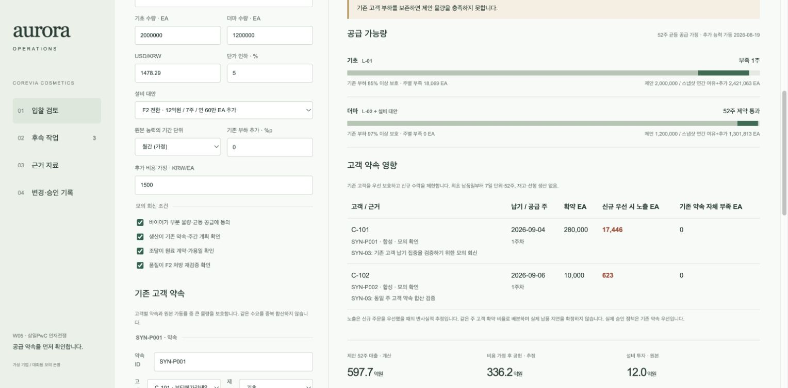
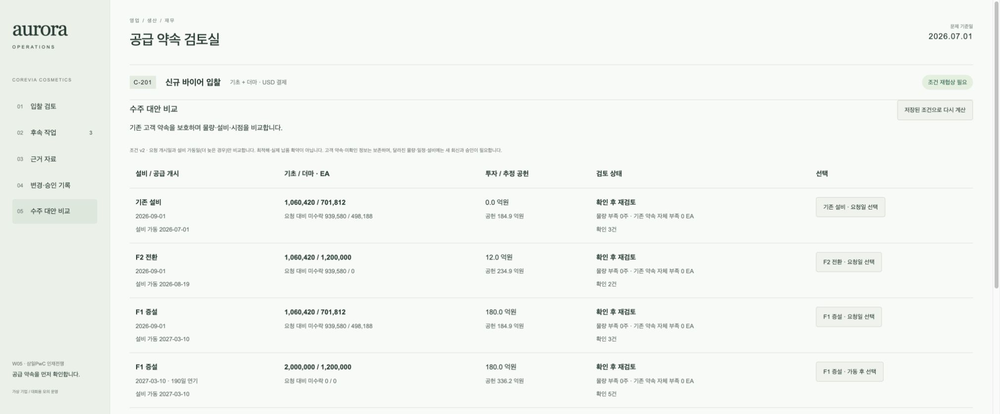
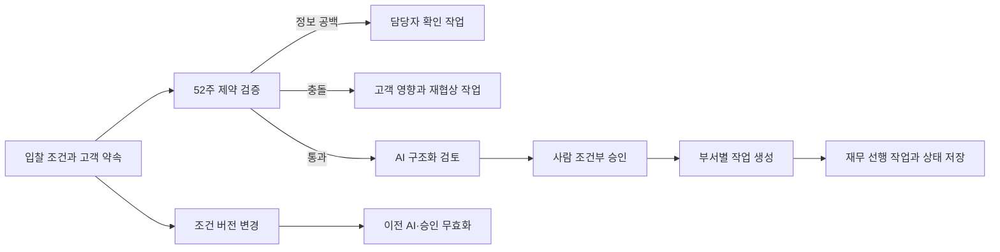

# Aurora · 공급 약속 검토실

**새 주문을 받기 전에, 기존 고객의 약속을 지킬 수 있는지 확인합니다.**

AX 인재전쟁 삼일PwC W05 「대형 수주와 기존 고객 약속」을 위한 로컬 운영 프로토타입입니다. 입찰 조건 → 생산 제약 검증 → AI 검토 → 사람 승인 → 부서 작업과 변경 이력을 연결합니다.

[대회 과제](https://axacademy.ai/axwar/samilpwc-1) · [개발자 dayainow](https://github.com/dayainow) · [초기 제출본 기록](docs/submission-v1.md)

> 2026-11-10: v1 대회 접수 완료. 이 저장소는 **고객별 약속 검증과 수주 대안 비교를 추가한 v3**입니다. v3 재제출용 소스입니다. 접수 결과는 대회 제출 내역을 기준으로 확인합니다. 가상 기업·모의 회신을 사용하는 프로젝트이며 삼일PwC의 공식 제품이나 수상작이 아닙니다.



## 해결하는 문제

연간 생산 여력이 남아 있어도 특정 주에 기존 고객의 납품이 몰리면 새 주문을 약속할 수 없습니다. 매출 전망과 승인 버튼만 연결하면 이 충돌을 놓치기 쉽습니다.

Aurora는 고객·제품·납기·확약 수량과 근거를 기록합니다. 기존 부하를 보호한 뒤 새 주문의 52주 공급을 검증하고, 충돌한 고객의 영업·생산 확인 작업을 생성합니다. 조건이 바뀌면 이전 AI 판단과 승인을 무효화합니다.

## 빠른 실행

Python 3.9 이상. 기본 실행에는 외부 패키지·API 키가 필요하지 않습니다.

```sh
git clone https://github.com/dayainow/dayainow.git
cd dayainow/aurora-w05
python3 server.py --port 8765
```

브라우저에서 http://127.0.0.1:8765 에 접속합니다. SQLite 상태는 `runtime/state.sqlite3`에 저장됩니다. 서버는 로컬 주소에만 바인딩됩니다.

```sh
# 데이터 삭제 없이 별도의 시연 세션 시작
AURORA_DB=runtime/review.sqlite3 python3 server.py --port 8766
# 계산·승인·상태 전이 검증
python3 -m unittest discover -s tests -v
```

## 고객 약속 검증: 3분 체험

1. **④ 약속 보호 · 모의 정상**: C-101 기초 20만 EA와 C-102 1만 EA의 같은 주 약속을 읽습니다. 원본 가동률 보호 하한 안에 있어 제안 조건의 계산이 통과합니다. AI 검토·승인은 별도입니다.
2. **⑤ 납기 집중 · 충돌**: C-101 약속이 28만 EA로 늘어납니다. 연간 여유가 있어도 첫 공급 주에 신규 물량 약 18,070 EA가 부족해 제안 승인이 막힙니다. 고객별 노출과 확인 작업 2건을 확인합니다.
3. **⑥ 고객 회신 미확인**: 미확인 약속도 예약 물량에서 제외하지 않습니다. 확인 요청 작업이 생성되고 승인 대기 단계로 넘어가지 않습니다.
4. 약속 물량·납기·근거를 직접 수정하고 **조건 저장 · 다시 검증**을 누릅니다. 후속 작업과 변경·승인 기록을 확인하고 새로고침해 저장 상태를 확인합니다.

①~③은 초기 제출본의 시나리오입니다. 고객별 약속 목록 없이 가동률만 보호하는 **v1 재현 모드**라고 표시합니다.

## v3: 실행으로 이어지는 수주 대안 비교

**⑤ 납기 집중 · 충돌 → 05 수주 대안 비교**에서 기존 설비, F2 전환, F1 증설을 비교합니다. 요청 개시일과 설비 가동일(더 늦는 경우)의 두 일정 후보만 검토하며 전역 최적해를 주장하지 않습니다.

- 각 제품의 52주 중 최소 주간 가용량 × 52를 정수로 내림해 균등 공급 가능한 물량을 구합니다. 요청 물량을 초과해 제안하지 않습니다.
- 같은 고객 약속·기간 단위·기존 부하·가격·비용 가정으로 투자액, 공급일, 수락/미수락 물량, 공헌 추정, 확인 과제와 병목 주를 비교합니다.
- 납기 집중 시 F2 전환안은 기초 **1,060,420 EA**, 더마 **1,200,000 EA**입니다. 기초 2백만 EA를 그대로 받으면 첫 주 약 18,069 EA가 부족하지만 이 대안은 수치 제약을 통과합니다.
- 대안 선택은 서버가 현재 조건에서 다시 계산한 결과만 사용합니다. 오래된 조건 버전이나 임의의 대안 ID는 거절합니다.
- 물량·일정·설비가 바뀌면 바이어와 생산 확인을 해제합니다. 설비·일정 변경 시 조달 확인도, F2 신규 선택 시 품질 확인도 다시 받습니다. 확인 없이 승인 단계로 넘어가지 않습니다.
- F1 가동 후로 미루어 과거 고객 약속이 검토 기간 밖으로 나가더라도 삭제하지 않고 별도 확인 과제로 남깁니다.
- **F2 전환 · 요청일 선택 → 바이어·생산 모의 회신 체크 → 조건 저장 → AI 검토 → CEO/이사회 모의 승인 → 작업 생성** 순으로 진행합니다. 제안서·투자 준비 작업에 선택한 설비·날짜·수량을 기록합니다. 무투자안에는 투자 준비 작업을 만들지 않습니다.



## 계산과 가정

- 원본 생산능력의 기간 단위는 미확인입니다. 월간·연간 가정을 사용자가 명시해야 합니다. 월간 해석은 원본 사실이 아닙니다.
- 보호 물량 = `max(원본 가동률 기반 주간 부하, 같은 주 고객 확약 합계)`. 두 수치는 겹치는 수요로 가정해 중복 합산하지 않으며, 약속 목록이 작아져도 원본 부하를 해제하지 않습니다.
- 신규 가용량 = `max(0, 주간 능력 + 가동 개시된 증설 능력 - 보호 물량)`. 모든 공급 주를 검사합니다.
- 최초 납품일부터 7일씩 52개 구간으로 평가합니다. 일반 달력의 주 번호가 아닙니다. 일별 생산·재고 이월·선행 생산·출하 소요시간은 모델링하지 않으므로 일 단위 납품 보증은 아닙니다.
- 검토 기간 밖 약속은 조용히 제외하지 않고 확인 과제를 만듭니다. 미확인 회신·누락된 목록 범위도 승인을 보류합니다.
- ‘신규 우선 시 노출’은 신규 수주를 먼저 배정했을 때 기존 고객이 노출되는 물량을 같은 주 고객 수량 비례로 나눈 **반사실적 추정**입니다. 실제 고객 지연이나 고객 우선순위 최적화를 뜻하지 않습니다. 운영 정책은 기존 약속 우선입니다.
- 고객 ID·제품 ID는 원본에 연결합니다. SYN-P001/P002의 미래 납기·수량·회신은 **참가자 합성 데이터**이며 실제 고객 약속이 아닙니다. 출처 구분·생성 이유를 함께 저장합니다.
- 기초·더마 2개 제품을 지원합니다. 추가 고객 근거는 참가자가 입력한 값이며 외부 시스템이 인증한 회신이 아닙니다.

## AI와 사람의 경계

AI는 정보 공백·위험·후속 작업을 구조화합니다. 수치 제약과 승인 권한은 코드로 검증하므로 AI의 PROPOSE 응답으로 공급 부족을 우회할 수 없습니다.

- 초기 v1 정상·변경·정보 부족 조건에서 **실제 Codex 호출 3회**를 실행했습니다. 저장된 응답은 입력 해시가 일치할 때만 재생합니다.
- **v3 실제 Codex 검증 3회를 추가 완료했습니다.** 선택 대안 회신 완료는 PROPOSE, 고객 납기 충돌은 RENEGOTIATE, 회신 미확인은 HOLD였습니다. 누적 6회이며 과거 응답을 새 조건에 재사용하지 않습니다. `data/review-inputs/`에 v3 재현 입력을 보관합니다.
- 새로운 조건은 앱의 프롬프트 복사 → 본인 AI 도구 실행 → JSON 응답 검증·반영 경로를 사용합니다. 수동 가져오기는 응답 생성자를 인증하지 않습니다.
- `review_once.py`는 명시적으로 실행할 때 모델 사용량을 소모합니다. 기본 앱은 자동 호출하거나 재시도하지 않습니다.
- CEO/이사회 승인, 담당자 확인·완료는 모의입니다. 실제 ERP·발주·지급·고객 메시지·다중 사용자 인증은 구현하지 않았습니다.

## 구조



- `alternatives.py`: 설비·일정 후보, 병목 주 기준 수락 물량 계산과 확인 조건 재설정.
- `engine.py`: 원본 파싱, 생산·재무 계산, 시나리오.
- `commitments.py`: 고객 약속 검증, 주별 보호 물량과 고객 노출.
- `store.py`: SQLite 트랜잭션, 버전·승인·작업 의존관계·감사 이력.
- `ai_adapter.py`: 구조화 프롬프트와 명시적 Codex 실행.
- `server.py`, `web/`: 로컬 API와 운영 화면.
- `tests/`: 제약·승인·고객 약속·실측 응답 해시 검증.

## 검증과 남은 범위

35개 자동 테스트: 기존 15개, 고객 약속 10개, 대안 비교·선택 9개, v3 실측 응답 1개(3조건 순회). 중복 합산 방지, 기존 부하 보호, 납기 집중, 미확인 회신, 기간 경계, 기존 약속 자체 과부하, 잘못된 입력, 변경 후 승인 무효화, 저장·복원과 과거 AI 응답 차단을 검증합니다.

브라우저에서 대안 비교 → F2 선택 → 회신 재확인 → 실측 AI 응답 재생 → 모의 승인 → 선택 조건의 작업 생성 → 재무 선행 작업 해제 → 조건 변경과 승인 무효화 → 미확인 보류를 확인했습니다. 현금 일정과 투자 계획의 연동, 자재·셋업·일별 납기와 전역 최적화는 후속 개발 항목입니다. 이 저장소의 기능 구현과 대회 제출 상태는 구분합니다.

## 개발 배경

Notion의 에픽·이슈·태스크로 팀 작업을 운영하고, Figma·GitHub·Notion을 연결한 프론트엔드 자동화와 팀 리딩 경험을 바탕으로 설계했습니다. Claude·Codex·Gemini를 Orca와 IDE에서 오케스트레이션하며 다룬 하네스·스킬·멀티에이전트 경험을, 조건·책임·검증·변경 이력이 남는 운영 흐름에 적용했습니다.

기획과 개발을 연결해 실제 운영까지 완성하는 것을 지향합니다. 이 프로젝트는 AI 도구와 함께 제작했으며 개인 경력 연차나 성과 수치를 임의로 주장하지 않습니다.

## 데이터 출처

`data/original/`은 대회에서 제공한 가상 기업 데이터 15개이며 `data/manifest.json`에 원본 SHA-256을 보관합니다. 원본 파일을 수정하지 않았습니다. 원본 데이터의 권리는 해당 제공자에게 있으며 별도 오픈 라이선스를 부여하지 않습니다. 원자료의 재사용은 대회 제공 조건을 확인해야 합니다.

개인 연락처, 참가 신청 정보, 브라우저 세션, 개발 대화 로그, 인증 키와 실행 DB는 공개 저장소에 포함하지 않습니다.

### AI 응답의 표현 검토

실측 AI 원문은 수정하지 않습니다. 일부 응답의 “입력 가동률 0%”는 기존 부하 자체가 아니라 추가 부하 `existing_load_pct=0`을 가리킵니다. “단순 회수기간”으로 표현한 값도 CAPEX/제안 전체 공헌이익 비율이며 실제 투자 회수기간이 아닙니다. 이 두 해석은 화면의 계산 기준과 함께 검토해야 합니다.
