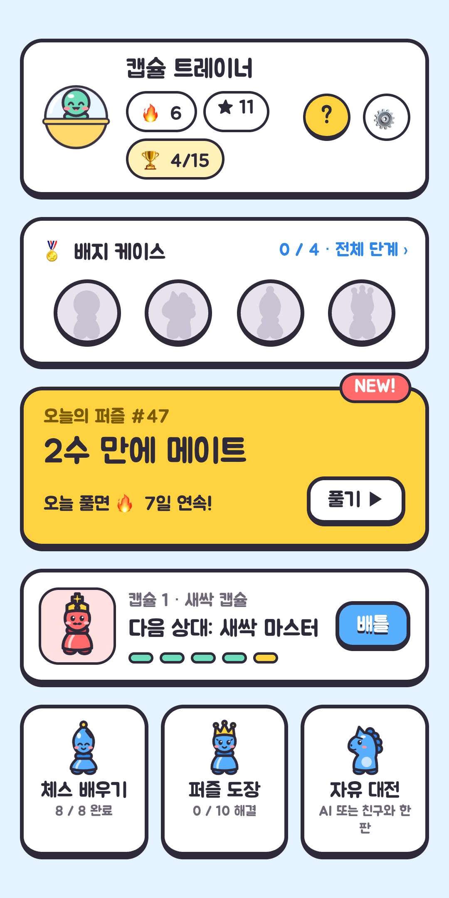
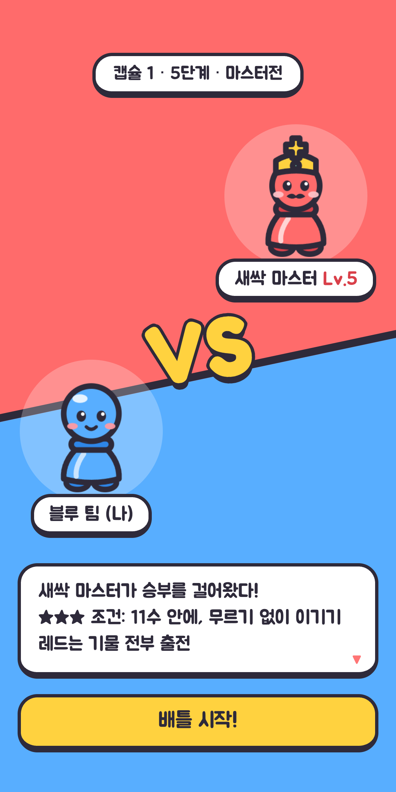
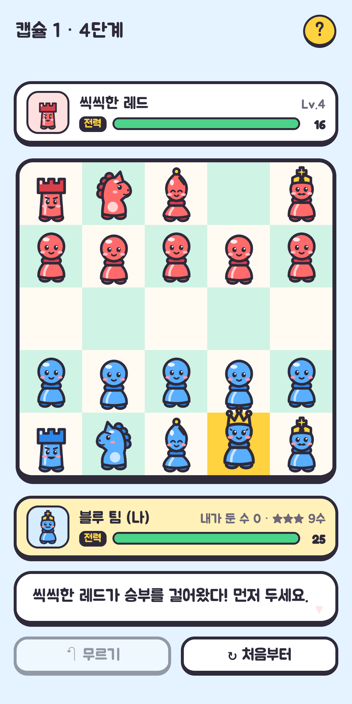
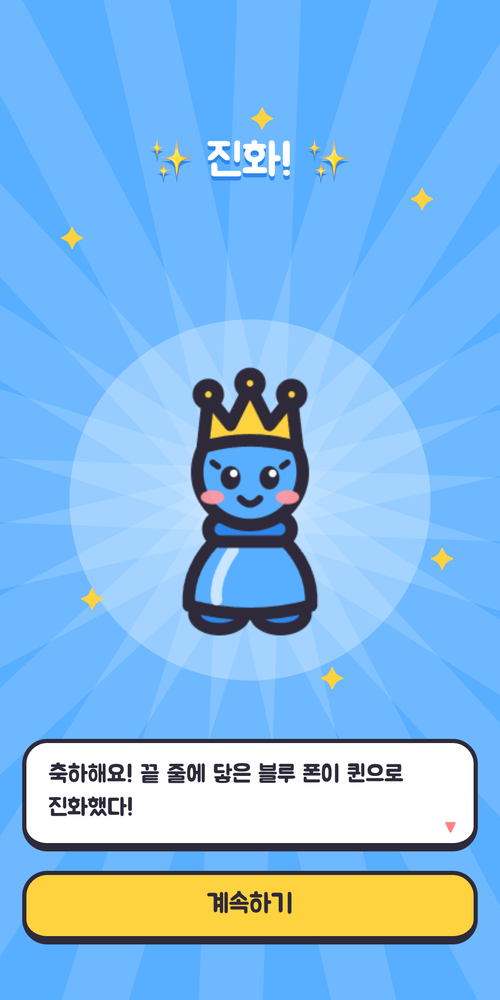

# 캡슐체스 (Capsule Chess)

5×5 작은 판에서 짧게 즐기는 미니 체스를, 귀여운 **몬스터 배틀 RPG** 감성으로 만든 Expo(React Native) 앱. 한국어·영어를 지원하며, Google Play 우선 출시를 준비하고 있습니다. Apple 출시는 개발자 등록 후 진행합니다.

[웹에서 플레이](https://dayainow.github.io/dayainow/) · [지원 및 개인정보처리방침](https://dayainow.github.io/dayainow/site/)

<p>
  
  
  
  
</p>

- 출시 계획과 진행 체크리스트: [docs/ROADMAP.md](docs/ROADMAP.md)
- UX·디자인 기획과 변경 기록: [docs/ux/UX_PLAN.md](docs/ux/UX_PLAN.md) · 디자인 시안: [docs/design/](docs/design/)
- 처음 만든 웹 프로토타입: [dayainow/dayainow](https://github.com/dayainow/dayainow)의 `minichess-prototype`

## 게임 구성

| 모드 | 내용 |
|---|---|
| **캡슐 리그** | 캡슐 4개 × 5단계, 상대 20명(캡슐마다 마스터전). 단계 시작 VS 화면, 별 3개 목표(힌트·무르기 없이), 캡슐을 다 깨면 배지 |
| **오늘의 퍼즐** | 매일 하나, 전 세계 같은 문제(2·3수 메이트). 연속 기록 🔥, 결과 공유 카드, 아침 9시 알림 |
| **퍼즐 도장** | 오늘의 퍼즐과 겹치지 않는 연습 퍼즐 120개 (1수 → 2수 → 3수, 순서대로 열림) |
| **체스 배우기** | 기물별 레슨 8개 (★ 모으기, 체크 벗어나기, 체크메이트) |
| **자유 대전** | AI(쉬움·보통·어려움) 또는 친구와 한 기기로 2인 대전 |

공통 요소: 첫 실행 **"첫 캡슐 열기"**(한 번 탭 → 블루 팀 등장 → 첫 배틀 조작 안내), 기물 몬스터 12종, 배틀 손맛(잡기 반짝이·전력 -N·체크/체크메이트 도장), 실황 대사 상자, 전력 게이지, 폰 → 퀸 **진화 연출**, 업적 15종, 첫 배틀 손가락 가이드, 어디서나 여는 규칙 안내(? 버튼), 판 꾸미기(업적 보상 7종), 한국어·영어.

**규칙(일반 체스와 다른 점)**: 5×5 판 · 폰은 처음에도 한 칸 · 캐슬링·앙파상 없음 · 끝 줄에 닿은 폰은 자동으로 퀸 · 체크 상태에서 둘 곳이 없으면 체크메이트, 체크가 아닌데 둘 곳이 없거나 킹만 남으면 무승부.

첫 캡슐 5단계, 오늘의 퍼즐, 도장 첫 10문제, 레슨과 자유 대전은 무료다. 나머지 리그와 도장은 앱 내에서 한 번 구매해 연다. [상품 설정과 결제 테스트](docs/store/monetization.md)

## 막히지 않고 끝까지 플레이하기

- 리그에서 힌트를 누르면 움직일 기물과 도착 칸을 손가락으로 안내합니다. 힌트·무르기를 사용한 판은 최대 별 2개이며, 새 판에서는 다시 별 3개에 도전할 수 있습니다.
- 패배 후 무료 1수 퍼즐을 연습할 수 있고, 승리 후에는 별 3개에 필요한 목표 수를 확인할 수 있습니다.
- 리그·자유 대전은 같은 배치와 차례가 3번 반복되거나, 잡기·폰 이동 없이 양쪽 합계 40수를 두면 무승부입니다. 한 판의 최대 길이는 양쪽 합계 80수이며 마지막 수의 체크메이트는 승리로 인정합니다.
- 종료까지 8수 이하로 남으면 조건과 남은 수를 안내합니다. 결과 화면에는 무승부 이유가 표시됩니다. 이 제한은 캡슐체스 전용 대전 규칙이며 퍼즐·레슨에는 적용하지 않습니다.

## 출시 준비 상태

2026-11-17 로컬 검증 기준: **자동 테스트 162개**, TypeScript 검사, Android·iOS·웹 JS 번들 생성 통과. 한국어·영어 브라우저에서 힌트·재시작과 반복 대전 → 무승부 → 새 판을 확인했습니다. 실제 사용자의 재미·플레이타임은 아직 검증하지 않았습니다.

웹·Expo Go는 무료 체험용이며 실제 스토어 결제를 지원하지 않습니다. 전체 게임 구매·복원은 스토어용 네이티브 빌드에서 검증해야 합니다. 진행 기록은 기기에 저장되며, 플랫폼 간 구매 이전이나 진행 동기화는 제공하지 않습니다.

**스토어 출시는 아직 완료되지 않았습니다.** 남은 보안 경고 처리, 공개 지원 이메일 확정, 콘솔 상품 등록, 최신 서명 빌드와 실기기 결제·복원 검증이 필요합니다. 기존 `1.0.0-3.aab`에는 이번 결제 기능이 없으므로 새 출시본으로 사용하지 않습니다. [출시 체크리스트](docs/store/release-checklist.md)

저장소 푸시와 공개 웹 배포는 별개입니다. GitHub Pages는 `Publish Capsule Chess web` 워크플로를 수동 실행해야 갱신됩니다.

## 실행

```bash
npm ci
npx expo start        # Expo Go로 무료 게임 흐름 확인 (스토어 결제·네이티브 기능 검증은 별도)
npm run web           # 브라우저에서 실행
npm test              # 자동 테스트 (Jest)
```

## 구조

| 경로 | 내용 |
|---|---|
| `app/` | 화면 (expo-router): 홈, 캡슐 리그 지도·배틀, 오늘의 퍼즐, 퍼즐 도장, 배우기, 자유 대전, 업적, 설정 |
| `src/engine/` | 규칙 엔진, AI(미니맥스 + 실수 확률), N수 메이트 풀이기 |
| `src/billing/` | 스토어 상품 조회, 전체 게임 구매·복원, 유료 콘텐츠 접근 제어 |
| `src/campaign/` | 20단계 난이도 표(`stages.ts`), 캡슐·상대·배지(`league.ts`) |
| `src/game/` | 한 판 상태(`useChessGame`), 퍼즐 풀이(`usePuzzle`), 실황 대사, 전력 계산, 첫 배틀·요청형 힌트, 종료 판정(`endings.ts`) |
| `src/puzzles/` | 데일리 퍼즐 550개(`bank.json`), 퍼즐 도장 120개(`practice.json`) |
| `src/achievements/` | 업적 15종 판정과 달성 알림 이벤트 |
| `src/ui/boardThemes.ts` | 판 테마 7종 (업적 보상) |
| `src/components/` | 보드(이동·손가락 가이드), VS 화면, 진화 연출, 결과·공유 카드, 규칙 안내, 업적 알림 |
| `src/ui/` | 디자인 시스템 부품: 패널, 장난감 버튼, 대사 상자, 전력 게이지, 기물 이미지, 배지, 글꼴 |
| `src/feedback/` | 효과음 + 진동 |
| `src/storage/` | 설정·진행 기록 저장 (AsyncStorage, 저장은 한 줄로 차례 처리) |
| `src/i18n/` | 한국어·영어 문구 (설정에서 변경, 기본값은 기기 언어) |
| `design/` | 기물 몬스터 원본(SVG 코드), 디자인 시안, 스토어 대표 이미지 |

## 디자인

"캡슐 리그": 굵은 잉크 외곽선 + 쨍한 블루·레드 팀 색 + 아래 그림자로 장난감·스티커 같은 손맛. 기물은 체스 실루엣을 그대로 살린 몬스터(얼굴·발·팀 색)라서 처음 보는 사람도 어떤 기물인지 바로 알아봄. 글꼴은 주아(한국어)·Fredoka(영어), 모두 OFL.

포켓몬 같은 몬스터 배틀 **감성**만 가져오고, 다른 작품의 이름·캐릭터·공 모양·로고 글꼴·유명 대사는 쓰지 않음.

## 생성 스크립트

에셋과 데이터는 스크립트로 만들어져 있어서, 숫자만 바꾸고 다시 실행하면 됨. 브라우저가 필요한 스크립트는 로컬 Edge/Chrome을 씀(`BROWSER_PATH`로 지정 가능).

```bash
node scripts/build-pieces.mjs       # 기물 몬스터 12종 PNG (design/creatures.mjs → assets/pieces/)
node scripts/build-icons.mjs        # 앱 아이콘·스플래시·마스코트 표정
node scripts/build-sounds.mjs       # 효과음 합성
node design/concept.mjs             # 디자인 시안 이미지
node design/feature.mjs             # 스토어 대표 이미지 (1024×500, 한·영)
node --no-warnings --import ./scripts/register-ts.mjs scripts/generate-puzzles.ts 400 150                       # 데일리 퍼즐
node --no-warnings --import ./scripts/register-ts.mjs scripts/generate-puzzles.ts 60 30 20261011 30 practice.json # 퍼즐 도장
node --no-warnings --import ./scripts/register-ts.mjs scripts/campaign-balance.ts 40                              # 단계 난이도 시뮬레이션
node scripts/store-screenshots.mjs  # 스토어 스크린샷 (개발 서버를 켠 상태에서)
node scripts/smoke-web.mjs          # 웹에서 모든 화면을 열어 오류 점검 (개발 서버를 켠 상태에서)
node scripts/smoke-hints.mjs http://localhost:8081/dayainow    # 한·영 힌트와 작은 화면
node scripts/smoke-endings.mjs http://localhost:8081/dayainow  # 한·영 반복 무승부와 새 판
npm run release:check               # 테스트·타입·3개 플랫폼 JS 번들, release/candidate/에 결과 저장
```

스토어 등록 절차와 입력할 내용: [Google Play](docs/store/google-play.md) · [App Store](docs/store/app-store.md)

출시 후보 확인: [완료 항목과 출시 조건](docs/store/release-checklist.md). `npm run release:check`로 테스트·타입 검사·3개 플랫폼 JS 번들을 검증하고 `release/candidate/`에 결과를 저장한다.

## 빌드 (EAS)

Expo 프로젝트 `@dayainow/capsule-chess`에 연결되어 있음. 서명 자격 증명은 각 스토어 계정과 EAS에서 확인한다.

```bash
npx eas-cli build -p android --profile preview      # 내 휴대폰에 바로 설치할 APK
npx eas-cli build -p android --profile production   # Google Play용 AAB
npx eas-cli build -p ios --profile ios-simulator    # 서명 없는 iOS 시뮬레이터 빌드
npx eas-cli build -p ios --profile production       # TestFlight / App Store용 서명 빌드
```

스토어 결제 검증에는 Google Play 내부 테스트 설치와 라이선스 테스터를 사용합니다. EAS 클라우드 빌드는 사용량이 차감될 수 있으며, 빌드 생성만으로 스토어에 제출되지는 않습니다.
