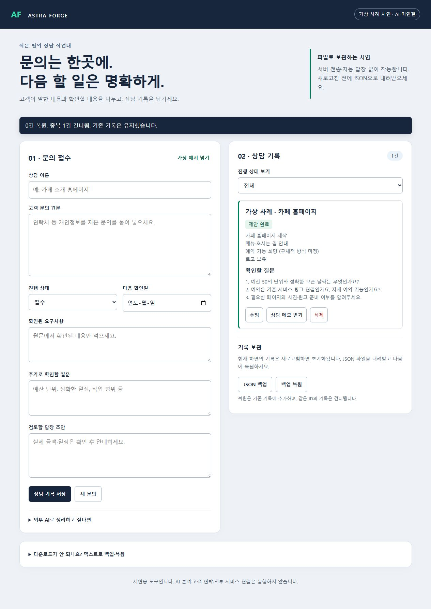
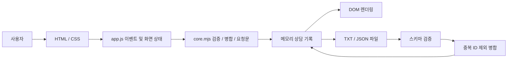
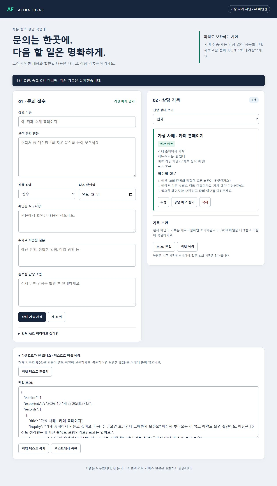

# Inquiry Desk · 문의 데스크



**문의 원문, 요구사항, 확인 질문, 답장 초안을 분리하고 상담 상태를 관리하는 파일 기반 사이드 프로젝트.**

기획·UI 구현·입력 검증·백업/복원 설계·실행 검증을 수행했습니다. 고객 실적이나 상용 SaaS가 아닌, 현재 소스만으로 실행 가능한 프로토타입으로 마감합니다.

## 해결하려는 문제

작은 팀이 고객 문의를 처리할 때 원문, 확정된 요구사항, 아직 확인해야 할 내용을 섞어 기록하기 쉽습니다. 이 정보를 분리하고 상담 기록과 후속 상태를 한 화면에서 확인하도록 구성했습니다.

## 주요 기능

| 영역 | 구현 |
| --- | --- |
| 상담 | 생성·수정·삭제, 상태 필터, 확인일 및 기한 초과 표시 |
| 검증 | 필수 항목, 길이, 실제 날짜, 허용 상태 검사 |
| 보관 | 상담 TXT 출력, 버전 1 JSON 백업 및 복원 |
| 복원 안전성 | 전체 검증 후 병합, 동일 ID 건너뛰기, 실패 시 원본 보존 |
| AI 보조 | 외부 AI에 직접 전달할 요청문 생성·복사. API 호출 없음 |
| UI | 한국어 레이블, 키보드 조작, 상태 알림, 반응형 레이아웃 |
| 선택 연동 | 지원 브라우저에서 WebMCP 조회·입력 준비. 미지원 브라우저에서도 기본 기능 동작 |

## 빠른 시작

Node.js 20 이상. 패키지 설치·API 키·DB·환경 파일이 필요하지 않습니다.

```sh
git clone https://github.com/dayainow/dayainow.git
cd dayainow/inquiry-desk
npm start
```

브라우저에서 **http://127.0.0.1:8765/** 를 엽니다. 포트 충돌 시 PowerShell에서 `$env:PORT=8877; npm start`로 변경합니다.

```sh
npm test
npm run build
```

`dist/index.html`은 ES 모듈이므로 더블클릭하지 말고 서버로 실행합니다. `portable/inquiry-desk.html`은 CSS·JS를 포함하는 단일 파일이며 `/portable.html`에서도 확인할 수 있습니다. 직접 파일 실행은 브라우저 정책에 따라 제한될 수 있습니다. 권장 실행 경로는 로컬 HTTP입니다.

## 아키텍처



HTTP 서버는 정적 파일만 제공합니다. 상담 내용은 서버로 전송하지 않습니다. 런타임 의존성 없이 DOM 조작과 도메인 로직을 분리해 검증·복원을 브라우저 없이 테스트합니다. 사용자 문자열은 HTML 대신 `textContent`로 표시합니다.

```text
inquiry-desk/
├── dist/                 # 정적 HTML/CSS/ES modules
│   ├── index.html
│   ├── style.css
│   ├── app.js            # 화면 상태·파일 입출력
│   └── core.mjs          # 검증·병합·요청문 로직
├── tests/core.test.mjs   # Node 내장 테스트
├── screenshots/          # 실제 화면, 가상 자료만 사용
├── portable/             # 생성된 단일 HTML
├── build-portable.mjs     # 번들 생성 및 구문 검사
└── server.mjs             # Node 내장 HTTP 서버
```

## 실행 화면

첫 화면은 가상 카페 문의를 저장하고 상태를 ‘제안 완료’로 바꾼 실행 결과입니다.



## 검증

2026-10-15: 핵심 테스트 5개 통과, 단일 HTML 생성·구문 검사 통과. 브라우저에서 생성·수정·상태 필터·텍스트 백업·새 세션 복원·중복 복원·잘못된 JSON의 원본 보존을 확인했습니다. Node 서버에서 HTML/CSS/모듈 응답과 단일 HTML 실행도 확인했습니다.

| 자동 테스트 | 검증 내용 |
| --- | --- |
| 백업 왕복 | 한국어와 모호한 예산 원문 보존 |
| 입력 검증 | 불가능한 날짜·누락된 문의 거부 |
| 백업 검증 | 잘못된 스키마·중복 ID·알 수 없는 상태 거부 |
| 병합 | 동일 ID의 기존 기록 보존 |
| 텍스트 처리 | 외부 마크업을 데이터로 유지, 요청문에 원문 경계 표시 |

## 제약과 설계 판단

- **메모리 저장:** 새로고침하면 초기화됩니다. JSON 파일 또는 텍스트 백업을 별도 보관해야 합니다. 자동 저장·동기화는 없습니다.
- 최대 500건, 파일 복원 5MB 제한. 같은 ID는 최신 여부와 무관하게 기존 기록을 유지합니다.
- 다운로드는 브라우저에 저장을 요청합니다. 파일 저장 여부를 직접 확인해야 하며 제한된 환경에서는 텍스트 백업을 사용합니다.
- AI 분석·자동 답장·메시지 발송·로그인·서버 DB는 구현하지 않았습니다. 예시 답장은 고정된 가상 자료입니다.
- 스택: **Vanilla JavaScript / HTML / CSS / Node.js 내장 모듈**. React 기반이 아닙니다.

## 프로젝트 마감

업무 도구 아이디어를 실행 가능한 프로토타입으로 만들고 기능·한계를 문서화했습니다. 유료 고객 확보나 매출 검증은 수행하지 않았으며, 사업 운영으로 확장하지 않고 사이드 프로젝트로 마감합니다.
